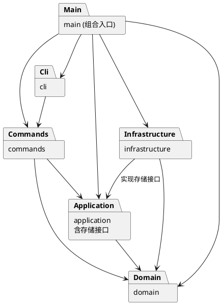
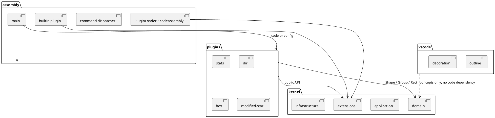

# SVG 编辑器：架构方案与开发记录

本项目使用 TypeScript 实现 CLI 版 SVG 编辑器，支持六种内置图形、文档读写、树结构编辑和撤销重做。开发中使用 Codex 辅助分析需求、生成实现与测试，并根据运行结果修订方案。

本文件为完整作业文档，包含使用说明、架构方案和开发记录。逐项验收结果见[最终检查记录](final-review.md)。

### 安装、运行与调试

需要 Node.js 22 或更新版本。以下命令均在项目根目录执行：

```powershell
npm.cmd ci
npm.cmd run cli
```

macOS、Linux 或其他终端可使用 `npm` 代替 `npm.cmd`。进入交互后输入 `help` 查看全部命令，Ctrl+C 或 EOF 退出。`src/` 中的 `.ts` 是源码，`dist/` 中的 `.js` 由 `npm run build` 生成。

用 VS Code 打开项目目录，在 `src/main.ts` 或 `src/cli/CliApplication.ts` 设置断点，按 F5 选择“调试 SVG CLI”，在集成终端输入命令。

### 命令与样例

支持 `init / read / save / canvas / create / delete / move / scale / set / group / ungroup / addto / front / back / tree / show / help / undo / redo`。

```text
init 400 300
create g node
create rect r 10 20 120 60 #4a90d9 in node
create text label 25 55 "开始" in node
move node 20 10
undo
tree
save demo.svg
```

交互终端显示 `svg>`；管道回放省略提示符。Windows PowerShell 回放中文脚本时先设置 UTF-8：

```powershell
$OutputEncoding = [System.Text.UTF8Encoding]::new($false)
Get-Content -Encoding utf8 examples/flowchart.commands.txt | npm.cmd run cli
```

完整脚本见 [flowchart.commands.txt](../examples/flowchart.commands.txt)，生成的 [flowchart.svg](../examples/flowchart.svg) 可直接用浏览器打开。`read examples/other.svg` 可读取作业外部样例并查看自动补 ID 警告。

显式 `save demo.svg` 后，无参数 `save` 使用最近一次成功 read/save 的路径；init 清除该路径。读写失败保留当前文档与历史。

## 1. 架构方案

### 1.1 模块划分

| 模块 | 职责 |
| --- | --- |
| `src/main.ts` | 组合入口，创建会话、工厂、存储实现和命令分发器 |
| `src/cli/` | REPL、参数分词、提示符，以及成功反馈和错误输出 |
| `src/commands/` | 独立命令类、参数校验和命令分发 |
| `src/application/` | 当前文档、历史管理、文档存储接口与结构查询 |
| `src/domain/` | 画布、图形、组合容器、树结构约束、工厂与状态快照 |
| `src/infrastructure/` | 文件读写、XML 解析和 SVG 序列化 |
| `tests/` | 领域行为、命令流程、历史恢复与文件往返测试 |
| `examples/`、`scripts/` | 可回放样例及浏览器视觉验收脚本 |

每个类放在同名文件中。图形属性和子节点集合由对象封装，通过方法维护数值、唯一 ID 和树结构约束。

以下为 PlantUML 包图，箭头表示依赖方向：



### 1.2 设计模式及实现

| 模式或原则 | 对应代码 | 选择理由 |
| --- | --- | --- |
| Command | `Command`、各命令类、`EditCommand`、`CommandHistory` | 将输入处理与编辑操作分开，一条成功编辑对应一个历史单元 |
| Composite | `Shape`、`Group`、`walk()` | 叶子与容器使用相同的 move/scale/set/delete 操作入口，嵌套容器通过多态遍历子树 |
| Memento | `SnapshotEdit`、`CanvasSnapshot`、`ShapeState` | 保存编辑前后状态，精确恢复属性、文本、父级及兄弟位置 |
| Factory 与适配器 | `ShapeFactory`、`ShapeInput`、`CommandShapeInput`、`XmlShapeInput` | CLI 和 XML 共用图形类型注册表，各自处理输入格式 |
| 依赖倒置 | `DocumentStore`、`FileDocumentStore` | 应用依赖存储接口，由入口注入文件实现，方便替换存储方式 |

历史管理在编辑成功后入栈，并清空 redo。失败编辑恢复操作前状态，保留已有历史。init/read/save 和画布尺寸修改在成功后建立历史屏障；tree/show/help 及尺寸查询不进入历史。

采用完整内存快照，是为了处理分组、子树删除和缺省属性恢复等情况，也能避免用反向缩放恢复时产生浮点误差。代价是每个历史单元占用 O(文档大小) 内存；本阶段未做差量压缩或磁盘历史。

按名字分派仅集中在 `CommandDispatcher` 和 `ShapeFactory` 两个注册表，均列为后续插件化阶段的待重构项。图形的几何操作、文本处理与子树遍历通过对象多态实现。

### 1.3 依赖方向规则

| 模块 | 允许依赖 | 原因 |
| --- | --- | --- |
| domain | 本层 | 保持模型独立于终端、文件系统和 XML 库 |
| application | 本层、domain | 协调用例，定义存储接口，管理当前文档与历史 |
| commands | 本层、application、domain | 校验命令参数并调用应用或领域对象 |
| cli | 本层、commands、Node 终端接口 | 负责交互，通过命令执行编辑 |
| infrastructure | 本层、application、domain、文件与 XML 库 | 实现存储接口，将外部格式转换为领域对象 |
| main.ts | 各业务模块 | 装配具体依赖 |

新增依赖需要符合此表；发生方案调整时，在过程记录中说明原因。

### 1.4 变化点假设

| 可能的变化 | 当前安排及取舍 |
| --- | --- |
| 新命令、GUI 或其他输入入口 | 命令对象与终端分离，其他入口可复用应用和领域操作 |
| 新图形类型 | 保留图形抽象和集中工厂；box 与插件加载属于后续阶段，本阶段不实现 |
| 存储媒介或 XML 库 | 用 DocumentStore 隔离应用与文件实现 |
| 新属性 | 各图形类维护自身属性规则，公共样式由基类处理 |
| 历史容量增大 | 历史集中管理，后续可替换快照策略；当前优先保证恢复准确 |
| 显示格式 | DocumentInspector 生成 tree/show 文本，CLI 负责输出 |

### 1.5 需求中的补充约定

- 仅以 `#` 开头的整行视为注释，颜色参数中的 `#` 保留；文本参数支持双引号和转义。
- group 按原文档遍历顺序收编节点。同父时占据首个所选节点的位置；跨父时插入最近公共祖先下、首个被选分支之前。
- 根级 g 禁止 ungroup；嵌套容器解组后，子节点占据原容器位置。addto/group 在修改前检查循环和祖先冲突。
- 普通 g 的样式遵循 SVG 继承。scale 缩放位置和几何尺寸，字号与描边宽度等样式保持原值。
- 外部 SVG 支持六种内置标签及无单位、px 几何长度；保留 viewBox、transform 和字体等属性。编辑作用于本地坐标，修改画布尺寸会重置 viewBox。其他标签、百分比及其他长度单位、DOCTYPE 报错；原始注释和排版不保留。

## 2. 与 AI 协作的过程记录

Codex 参与了需求拆解、项目骨架、领域模型、命令、测试和文档的编写。协作中主要依据作业要求、类型检查、回归测试和实际渲染结果判断方案是否可用。下面记录有代表性的调整。

### 2.1 从骨架到领域模型

先建立 TypeScript 严格模式配置和模块方案，再实现图形及容器。检查容器移动、缩放时发现：如果逐个修改子节点，后面的节点数值溢出会留下部分修改。于是改为先计算并验证整棵子树，再统一写回；测试用后续节点溢出的场景确认前面节点保持原值。

运行时测试通过后，类型检查仍发现 `Shape` 与 `ShapeContainer` 的身份比较存在类型错误。修正比较方式后，把测试源码也纳入类型检查。另补充 `.vscode/launch.json`，通过 `node --import tsx` 在集成终端启动 CLI。

### 2.2 命令解析与撤销重做

CLI 解析保留参数是否带引号的信息，用于区分文本内容 `"in"` 和容器后缀 `in <id>`，并避免将颜色当作注释。

撤销方案从保存操作差量调整为编辑前后快照。重点验证了：分组一次撤销还原全部节点、删除后恢复子树、原本未设置的样式恢复为缺省状态，以及浮点几何值精确恢复。模拟编辑中途抛错后，文档和已有 redo 均能恢复。

### 2.3 工厂迁移与 SVG 读写

工厂最初位于命令层。实现 XML 读入时发现，直接复用会使 infrastructure 依赖 commands，违反方案。随后将 `ShapeFactory` 移入 domain，并提取 `ShapeInput`，由 CLI 和 XML 分别适配输入。

导入 viewBox 后，检查撤销发现快照恢复调用 resize 会清除根属性。改为由 Canvas 封装尺寸和根属性快照，并补充导入、编辑、撤销、保存读回的测试。

### 2.4 根据失败用例修复解析和保存问题

以下问题均先通过失败用例复现，再修复并运行相关及完整测试：

| 问题 | 调整与验证 |
| --- | --- |
| Number(value) 接受 `0x10` 等进制字符串 | 增加十进制浮点及指数格式校验；非法设置保留原属性 |
| 注释或 CDATA 中的 DOCTYPE 字样被误拒绝 | 检查实际 Document.doctype 节点，普通文本可保存读回，真实 DOCTYPE 继续拒绝 |
| `stroke-width="2px"` 及带首尾空白的长度无法导入 | 统一 SVG 长度解析，保留数值、单位和非负检查 |
| `stroke-width="inherit"` 无法导入 | 导入时保留继承关键字，验证读回和快照恢复 |
| 回车字符实体保存后变成换行 | 序列化时用字符引用保留回车，验证回车、换行、制表符往返 |
| XML 禁用控制字符被写入文件 | 启用严格序列化，验证保存失败时原文件和命令历史不变 |

### 2.5 样例回放与视觉验收

最初分析将流程图误数为 9 个元素；实际回放确认是 8 个，原需求正确。以运行结果纠正了计数和文档说明。

Windows PowerShell 的默认管道编码曾使中文变成问号，设置 UTF-8 后重新生成例图，并用独立 Node 进程回放确认中文内容。

使用 Playwright 调用本机 Edge，生成原图、节点移动、整体缩放和撤销恢复四种状态的截图。检查了中文、颜色、文本范围和节点位置；撤销恢复图与原图逐字节一致。截图和测量结果见[视觉验收记录](visual-acceptance.md)。

## 3. 一致性自查

### 模块划分

实际业务目录与方案一致，另有 examples 和 scripts 用于样例与验收。工厂迁移、历史快照策略和外部 SVG 支持范围的调整已记入过程记录。

### 依赖方向

最终检查覆盖 54 个模块文件、49 个类及 175 处导入，类名与文件名一致，未发现违反当前依赖规则的导入。具体例子：

- `SnapshotEdit` 依赖 domain 的快照对象，应用层不引用具体命令类。
- `FileDocumentStore` 实现 application 的存储接口；`SvgCodec` 使用 domain 的工厂，不引用 commands。
- domain 不依赖终端、文件系统或 XML 库；命令类不直接执行终端与文件 IO。

检查范围和逐项依据见[最终检查记录](final-review.md)。

## 4. 功能完整性与质量保证

已接齐需求中的 19 个命令。当前 34 项自动化测试、类型检查、构建和 Edge 视觉验收均通过。

| 验证范围 | 重点检查 |
| --- | --- |
| 领域模型 | 六种图形、嵌套容器、移动缩放、属性白名单、唯一 ID、数值及循环约束 |
| 命令与交互 | 双引号、转义、颜色、空文本、错误后继续执行、CRLF 与无末尾换行脚本 |
| 历史与层级 | 整段命令撤销重做、跨父分组、解组顺序、重新归属、z-order、历史分支和文档屏障 |
| SVG 与文件 | XML 转义、缺 ID 补全、重复 ID、默认路径、失败保护、属性及文本往返 |
| 需求样例 | 外部 SVG 的 7 个元素、完整流程图的 8 个元素及中文内容 |
| 浏览器渲染 | 四种状态的文字、颜色、几何位置，以及撤销前后截图一致性 |

复现命令：

```powershell
npm.cmd ci
npm.cmd run check
npm.cmd test
npm.cmd run build
npm.cmd run visual:check
```

视觉验收需要本机 Edge。当前验证环境为 Windows、Node.js 24.14.0、Edge 156.0.4314.42；其他平台尚未验证。超大文档性能、任意外部 SVG 和插件加载不在本阶段验证范围内。

代码与文档已推送至 [GitHub](https://github.com/AutNiHilo-carry/svg-editor-cli)，交付版本由 [final 标签](https://github.com/AutNiHilo-carry/svg-editor-cli/tree/final)标记。

---

# Phase 2：插件实践与插件式重构

## 1. 扩展点清单

四个接口均定义在内核 `src/extensions/`，内核只依赖接口；具体实现放在 `src/builtin/` 或 `plugins/`。

| 扩展点 | 接口/注册表 | 内核调用位置 | 已有实现 | 未加载可选插件时 | 违约时 |
|---|---|---|---|---|---|
| `ShapeProvider` | `ShapeProvider.ts`，`ShapeFactory.register/create` | `CreateCommand.apply`、`SvgCodec.decodeShape` | `BuiltinShapes.ts` 六种；`box` | 六种内置图形仍可用；`box` 报 `unknown shape type: box (is the plugin loaded?)` | id 冲突由 `ShapeCollection.insert` 拒绝；读回缺必要子部件抛 `invalid SVG`；provider 返回错误 id 拒绝 |
| `Command` | `CommandDescriptor.ts`，`CommandDispatcher.register/dispatch` | `CommandDispatcher.dispatch` | 17 个内置命令；`stats`、`dir` | 内置命令不变；未加载时报 `unknown command: stats/dir` | 同名注册抛 `duplicate registration: commands/<name>` |
| `TreeDecorator` | `TreeDecorator.ts`，`PluginRegistry.registerDecorator` | `DocumentInspector.tags` | `(box)`、`modified-star` | 树输出与 Phase 1 完全一致，无标签 | 重复名拒绝；装饰器抛错由命令边界转成一行 `error:` |
| `AttributeHandler` | `AttributeHandler.ts`，`PluginRegistry.registerAttribute` | `SetCommand.apply` | box 的 `fill`、`label` | 回退 Phase 1 白名单；未知属性报 `unknown attribute` | 多个命中拒绝 `ambiguous attribute handler`；`apply` 抛错由 `SnapshotEdit` 整体回滚 |

插件注册统一走 `src/extensions/activatePlugin.ts`：先 staging，校验 `contributes` 名称集合，再检查全局重复，全部通过才 commit；任何失败丢弃全部暂存注册和事件订阅。

## 2. 重构后的模块与依赖



内核不导入 `plugins/`；`stats` 与 `dir` 是独立 npm workspace 包，`box` 与 `modified-star` 同理。内置六种图形也通过 `ShapeProvider` 注册，但保留在宿主侧作为默认能力。

## 3. 两种装配方式

**方式 A：代码装配**（`src/host/codeAssembly.ts`）

```ts
export const codePluginSpecifiers = [
  '@svgframe/plugin-command-stats',
  '@svgframe/plugin-command-dir',
  '@svgframe/plugin-shape-box',
  '@svgframe/plugin-tree-modified-star',
];
```

`loadCodePlugins` 逐个动态导入并调用 `activatePlugin`；新增插件需要改这一处并重新构建。

**方式 B：配置装配**（`plugins.config.json`）

```json
{
  "plugins": [
    { "module": "@svgframe/plugin-command-stats" },
    { "module": "@svgframe/plugin-command-dir" },
    { "module": "@svgframe/plugin-shape-box" },
    { "module": "@svgframe/plugin-tree-modified-star" }
  ]
}
```

```powershell
node dist/main.js --config plugins.config.json
node dist/main.js --no-plugins   # 对照 Phase 1
```

加载器按数组顺序加载，`enabled:false` 完全跳过；相对路径以配置文件目录为基准，包名按 Node 解析；`options` 原样传给 `PluginContext.options`。`Package.json.contributes` 优先于源码内声明。

四条失败路径：`plugin not found`、`plugin has no default export`、`plugin manifest mismatch`、`plugin failed to activate`。重复注册、manifest 不一致、activate 抛错都会撤销该插件的暂存注册，保留已成功插件并继续启动。非法配置打印 `error: invalid plugin config`，以默认内置能力启动。

## 4. Box 与属性契约

- `Box` 继承 `Group`，`type='box'`、`svgTag='g'`，内部 id 为 `<id>-rect` / `<id>-label`。
- 创建：`create box n1 120 100 160 60 "开始"` 一条命令生成三个元素；`box` 可 `in`、被 `group`、嵌套 box。
- 序列化：`<g id="n1" data-kind="box">`。
- 读回：`data-kind` 命中 `ShapeProvider` 才还原；无插件时降级为普通 `g` 并告警；有插件但缺必要子部件时拒绝整个读入，不生成半成品。
- 属性：`fill` 传播到 `n1-rect`，`label` 改写 `n1-label`；由 `BoxAttributeHandler` 处理，不扩张内核白名单。
- 不变量：`ungroup`、删除/移走必要子部件被拒绝；`CanvasSnapshot` 恢复走 `forceRemove` 内部路径，避免回滚被插件不变量卡住。

## 5. dir 适配器

- Target：`DirectoryReader.list(path)`。
- Adaptee：Node `fs.readdirSync(..., { withFileTypes: true })`。
- Adapter：`NodeDirectoryAdapter`。
- Client：`DirCommand`，只依赖 `DirectoryReader`，测试可注入测试替身。
- 目录在前、文件在后，组内按 UTF-16 码元升序；隐藏项包含，`.`/`..` 不出现；符号链接显示 `[LINK]` 且不跟随。
- `dir` 不 require 文档，不改变文档、dirty 状态、cwd 或 undo 历史。

## 6. ADR

**ADR-1 属性处理器契约**：`handles` 必须无副作用；多个命中直接拒绝，不做隐式优先级；一次 `set` 由 `SnapshotEdit` 包裹，整棵画布快照保证单 undo 单元；处理器抛错时恢复快照且 `CommandHistory` 不 push。

**ADR-2 box 读回降级**：合法 box 必须能从 `data-kind` + 两个固定子部件还原；子部件缺失/类型错误拒绝整个 `read`，保证内存中不存在半成品。未安装插件时按普通 `g` 读入，保留 `data-kind` 属性，后续保存不丢信息。

**ADR-3 dirty 语义**：采用“内容与上次保存不一致”，不是“发生过编辑”。`modified-star` 在实例字段保存每个元素及整棵树的指纹；子树指纹包含后代，因此子元素变化会标记祖先；新节点无基线立即标星；`undo` 回到保存点后指纹相等，星号消失。标签顺序按装饰器注册顺序，`(box)` 在前、`*` 在后。

**ADR-4 清单校验时机**：在 `activate` 完成后、commit 前校验 `contributes`；暂存期只做类别内重复检查，全局重复在 commit 前统一检查。这样既能让插件先完成全部注册再声明，也能保证失败回滚。

## 7. VSCode 部分分析

- VSCode 负责 Explorer、编辑器、原生 Outline 视图、文件事件与渲染；扩展只注册 `FileDecorationProvider` 和 `DocumentSymbolProvider`，由 VSCode 在合适的时机调用。
- `provideFileDecoration` 只返回 `{badge:'[]'}`，不重命名、不修改文件；非 `.svg` 和目录返回 `undefined`。
- `provideDocumentSymbols` 把 XML 元素树映射为 `DocumentSymbol`；`range` 覆盖整个元素，`selectionRange` 指向开始标签，点击可定位。坏 XML 时捕获异常返回空数组。
- 与经典 Decorator 模式：VSCode 的 FileDecoration 是“附加显示信息”，不是对象包装；扩展提供装饰数据，VSCode 负责组合渲染。与 Adapter 模式：`DocumentSymbolProvider` 把扩展的 XML 模型适配成 VSCode 的符号协议，`FileDecorationProvider` 把 URI 适配成装饰对象。二者都是“接口适配 + 宿主回调”，但装饰结果不改变原对象。
- Phase 1 复用：可直接复用的是“元素/容器树、id 语义、XML 健壮性处理”这些概念；CLI 的 `SvgCodec` 依赖 Canvas、命令历史和 `Shape` 实例，且不保留源码 offset，不能直接用于 Outline。强行复用会把 UI 与 CLI 内核耦合，因此扩展保留独立的轻量 offset parser，只复用规则和测试样例。

## 8. AI 协作中的检查与修正

- 最初把插件通过 `node_modules` 符号链接导入，导致 `Group`/`Shape` 出现两份模块实例，`instanceof` 判断失效；用 `realpathSync.native` 加载真实插件路径，并以 `isShapeContainer` 结构判断兜底。
- `box` 的 create 与 restore 共用一个 provider，读回时重复创建子部件导致 `id already exists`；增加 `mode: 'create' | 'restore'`，restore 只创建空壳，由 codec 插入子部件。
- `SnapshotEdit` 回滚时若直接调用受保护的 `remove`，会被 box 的必要子部件不变量拒绝；增加仅供快照恢复使用的 `forceRemove` 路径。
- `set fill` 最初绕过处理器，原因是 `SetCommand` 改动没有进入实际 apply；补上 handler 查找和冲突拒绝后才通过。
- 加载器最初用 `require.resolve` 的符号链接路径，导致插件内相对导入指向错误目录；统一用真实路径后解决。

## 9. 一致性自查与质量保证

- 实际目录与方案一致：扩展点位于 `src/extensions`，装配位于 `src/host`，插件位于 `plugins/*`，VSCode 扩展独立于 `vscode-extension/`。
- 依赖方向：`src/extensions` 不导入 `plugins` 或 `vscode`；`src/host` 依赖扩展点；插件只依赖 `svg-editor-cli` 的公开 barrel 和 Node 标准库。
- `--no-plugins` 的 Phase 1 transcript 已逐字节对比通过。
- 测试：Phase 1 回归、`stats`/`dir`、loader 6 条、box 不变量与 round-trip、`modified-star` 状态机、代码/配置装配逐字节一致、VSCode outline 5 条。
- 指标：见 `docs/metrics/`，数字由 `scripts/metrics.mjs` 从 `final..HEAD` 生成。

真实 VSCode 截图需要在有 GUI 的桌面环境运行 `vscode-extension` 后补入 `docs/images/`；本沙箱禁止 Electron 创建 named pipe，无法在此生成可信截图，未使用伪造图片。
