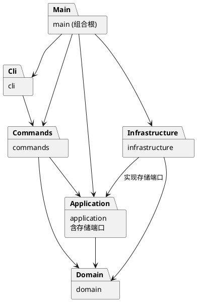

# 架构方案与开发记录

## 1. 架构方案

### 模块划分

以下为目标结构；当前已建立入口、CLI 启动类、领域模型与领域测试，其余模块随功能逐步加入。

| 模块 | 职责 |
| --- | --- |
| `src/main.ts` | 组合根：创建对象、连接依赖并启动应用 |
| `src/cli/` | REPL、带引号参数解析、提示符、错误和反馈输出 |
| `src/application/` | 当前文档会话、用例协调、撤销重做历史、存储端口接口 |
| `src/commands/` | 命令对象、参数校验、编辑执行及撤销重做 |
| `src/domain/` | 画布、图形基类、六种图形、容器、ID 唯一性和树结构约束 |
| `src/infrastructure/` | 文件读写及 SVG XML 编解码，实现存储端口 |
| `tests/` | 领域行为、命令历史、SVG 往返及 CLI 验收测试 |

每个类单独放在同名文件中，字段封装，通过方法维护不变量。

### 设计模式的选择

- **Command（必需，待实现）**：每条编辑操作封装为命令对象，提供执行、撤销和重做。一个成功编辑命令对应一个历史单元，失败命令不入栈。命令保留恢复所需的属性、父节点及兄弟位置；复杂树操作在修改前完成校验。
- **Composite（已实现领域部分）**：抽象图形 `Shape` 统一暴露移动、缩放、设置属性等操作，`Group` 重写 `walk()` 提供包含自身的子树。移动与缩放通过此多态遍历作用于全部子孙；叶子类实现各自的坐标平移，无按标签分派操作。
- **Factory（待实现）**：图形工厂集中创建六种内置图形；SVG 解码也通过工厂还原图形。暂不实现插件系统。
- **依赖倒置（待实现）**：应用定义文档存储端口，文件与 XML 实现位于基础设施，由入口注入。

仅允许两处按名字分派：命令分发器和图形工厂。这两处标为后续插件化阶段的待重构项；几何操作、属性设置和展示由对象多态完成，不散布 `switch(tag)`。

### 依赖方向规则

1. `domain` 不依赖其他业务模块、Node 文件系统或终端，保证模型可独立验证。
2. `application` 只依赖 `domain`，并拥有存储端口；不直接读写文件。
3. `commands` 可依赖 `application` 和 `domain`，不依赖具体终端或文件实现。
4. `cli` 依赖命令接口和分发器，不直接修改图形或访问文件。
5. `infrastructure` 可依赖 `application` 的端口和 `domain`，不得反向驱动 CLI。
6. `main.ts` 作为组合根可以引用各模块完成装配，不承载业务逻辑。

违反上述规则的依赖应记录并处理，不能以“方便调用”为理由隐式绕过。

### 变化点假设

| 变化点 | 当前决定 |
| --- | --- |
| 新命令或交互入口 | 命令对象独立于终端，未来入口复用应用用例 |
| 新图形类型 | 以图形抽象与集中工厂隔离变化；暂不实现插件加载、`box` 或通用插件框架 |
| 存储媒介和 XML 库 | 用存储端口隔离文件路径和编码细节 |
| 新图形属性 | 各图形类维护自身白名单，通过多态处理 |
| 历史存储策略 | 由历史管理类集中维护，初期采用内存历史，不做磁盘历史 |
| 展示格式 | 与命令状态变更分离；先满足作业规定的 tree/show 格式 |

### 实现前需落实的语义

- 仅整行以 `#` 开头才视为注释，颜色中的 `#` 保留；解析需支持双引号字符串。
- 成功的 init/read/save 和修改画布尺寸建立历史屏障；无参数 canvas 查询不影响历史。失败操作保持文档与历史不变。
- 普通 g 的公共样式设在容器上，遵循 SVG 继承；几何 move/scale 递归作用于子节点。scale 同时缩放位置与尺寸，不擅自扩大到 stroke-width 等样式。
- 顶层 g 禁止 ungroup。addto/group 必须预先检查祖先关系，防止循环和重复操作。
- 跨父容器 group 的顺序与位置暂约定：按操作前文档遍历顺序排列所选节点，新组插入它们最近公共祖先下、第一个被选分支之前；同父场景占据第一个被选节点的位置。实现和测试必须同时验证该约定。
- 外部 SVG 的支持范围在读写阶段明确；特别是 transform、未知标签、重复 id 和不支持的属性，不能静默丢弃后声称无损读回。作业开头有 transform 示例，因此应优先研究 translate/scale 的支持。

## 2. 过程记录

### 2026-10-25：初始化与方案草稿

- 阅读作业要求，确认本阶段只需六种内置类型，box 和插件加载属于后续目标。
- 初始目录只有需求 Markdown，没有 Git 仓库或实现代码。
- 建立 TypeScript 严格模式配置、CLI 启动类、构建脚本和忽略规则。
- 在写实现前记录模块职责、依赖方向和待确认语义，避免先完成全部代码再补造过程记录。
- 发现流程图版本 A 的元素和 create 命令实际为 9，原示例写为 8；后续计数以真实树节点数为准，不含 svg 根。

后续每个阶段补充实际遇到的问题、验证方式及修订决定，不预先填写未发生的工作。

### 2026-10-25：图形与画布模型

- 添加 `Shape`、`Rect`、`Circle`、`Ellipse`、`Line`、`Text`、`Group` 和 `Canvas`，所有类均一类一文件。几何、样式、文本和子节点集合封装，查询仅返回冻结副本。
- 引入 `ShapeContainer` 接口和 `ShapeCollection` 管理树关系。容器插入统一支持重新归属，先验证 ID 冲突、循环和插入位置，再修改原父级。父关系存于私有 WeakMap，无对外 setter。
- 开发中识别到逐个修改子节点可能导致失败后状态只改一半：将容器 move/scale 改为先计算并验证整棵子树的结果，再统一写回；用后续节点发生数值溢出的用例验证前面节点仍保持原值。
- 限制非有限数值、负尺寸与非法缩放；普通 g 的 fill/stroke 等样式保存在容器，不主动覆盖子节点。
- 运行时测试通过后，类型检查仍发现 Shape 与 ShapeContainer 直接比较的静态类型错误，改用 Object.is 判断身份；同时将测试源码纳入类型检查，避免仅通过 tsx 运行而遗漏类型问题。
- 本阶段尚未实现命令、REPL、撤销重做和 SVG 读写，未提前声称编辑器功能完成。

### 调试配置补充

- 添加 `.vscode/launch.json`，提供“调试 SVG CLI”配置，通过 `node --import tsx` 启动 TypeScript 入口，并使用集成终端保留交互输入能力。
- 验证配置 JSON 可解析、入口路径存在，并运行同一启动命令确认加载成功；未自动操作 VS Code 验证断点命中。
- 该提交仅补充开发调试工具与说明，不改变领域模型。

### 数值属性校验缺陷修复

- 发现几何属性与 stroke-width 直接使用 Number(value)，将 `0x10`、`0b10`、`0o10` 等字符串误识别为坐标数值；明确字符串输入采用十进制浮点和指数格式。
- 先补回归测试并执行，确认旧代码在 `x=0x10` 时未抛错，得到 7 项通过、1 项失败的复现结果。
- 转换前增加完整字符串格式校验，继续检查转换结果是否有限；保留正负号、小数、指数和首尾空白的支持。非法属性设置不改变原状态。
- 修复后执行全部 8 项领域测试、生产与测试代码类型检查、构建，均通过；模块与依赖方向不变。

## 3. 一致性自查

- 当前已实现 `src/main.ts`、`src/cli/`、`src/domain/` 和 `tests/`，与分步计划一致；目标目录尚未全部建立。
- 领域模型仅依赖领域模块，无终端、文件系统、命令层或应用层依赖；类型引用使用 import type。入口引用 CLI 启动类，无跨层反向依赖。
- Composite 已在领域模型落地；Command、工厂和存储端口尚未实现。
- 完成实现后需重新检查实际目录与 import 关系，并在此记录偏差和修订。

## 4. 质量保证手段

初始化阶段执行类型检查、构建及 CLI 启动检查；这些只能证明骨架可构建启动，不能证明编辑器功能完成。

本阶段实际验证结果（2026-10-25）：`npm.cmd run check`、`npm.cmd run build`、`npm.cmd run cli` 均成功，CLI 输出当前骨架状态。依赖安装成功并生成 package-lock.json，供后续使用 `npm ci` 复现。

领域模型阶段验证：通过 `npm.cmd test` 验证嵌套图形移动缩放、全局 ID 冲突、重新归属与排序、循环拒绝、数值与属性白名单、失败原子性、画布查询；共 7 项行为测试。`npm.cmd run check` 同时检查生产代码和测试代码，另执行构建验证。

后续计划：

1. 验证六种图形的几何操作、属性白名单、唯一 id、非法参数及失败原子性。
2. 验证嵌套容器、跨父分组、循环拒绝、解组顺序和同级 z-order。
3. 验证每条编辑命令的撤销重做、新编辑清空 redo、文档操作的历史屏障。
4. 验证 SVG 保存读回、XML 转义、缺 id 自动补全及与已有 id 的冲突规避。
5. 回放作业的典型会话和流程图案例，并用浏览器查看保存结果。
6. 最终检查提交历史、远程推送和 final 标签；当前阶段不创建 final 标签。
