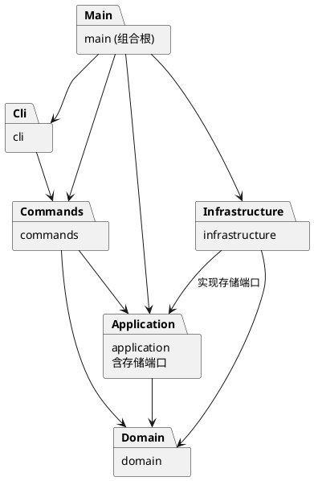

# 架构方案与开发记录

## 1. 架构方案

### 模块划分

以下结构均已建立；按初始化、领域模型、CLI、历史与层级、SVG 读写逐步提交。

| 模块 | 职责 |
| --- | --- |
| `src/main.ts` | 组合根：创建对象、连接依赖并启动应用 |
| `src/cli/` | REPL、带引号参数解析、提示符、错误和反馈输出 |
| `src/application/` | 当前文档会话、用例协调、撤销重做历史、存储端口接口 |
| `src/commands/` | 命令对象、参数校验、编辑执行及撤销重做 |
| `src/domain/` | 画布、图形基类、六种图形、容器、ID 唯一性和树结构约束 |
| `src/infrastructure/` | 文件读写及 SVG XML 编解码，实现存储端口 |
| `tests/` | 领域行为、命令历史、SVG 往返及 CLI 验收测试 |

每个类单独放在同名文件中，字段封装，通过方法维护不变量。

### 设计模式的选择

- **Command（已实现）**：每条基础操作封装为独立命令类，由 `CommandDispatcher` 创建并执行。编辑命令继承 `EditCommand`，由会话和 `CommandHistory` 调用 `UndoableAction` 的 execute/undo/redo。成功执行后才入栈并清空 redo，失败操作不改历史；文档操作在成功后建立屏障，查询不入栈。
- **Memento（历史实现）**：`SnapshotEdit` 保存编辑前后的 `CanvasSnapshot`；图形通过多态 `captureState()` 返回封装的 `ShapeState`，文本类补充自身内容恢复逻辑。快照记录实际对象、各容器子节点顺序和属性，恢复时先清空相关容器，再重建树，不需要按标签分派，也不依赖反向运算。修订原逐命令保存差量的设想，优先保证精确恢复和原子性，代价为每条历史占用 O(文档大小) 内存；本阶段不优化为差量或持久化历史。
- **Composite（已实现领域部分）**：抽象图形 `Shape` 统一暴露移动、缩放、设置属性等操作，`Group` 重写 `walk()` 提供包含自身的子树。移动与缩放通过此多态遍历作用于全部子孙；叶子类实现各自的坐标平移，无按标签分派操作。
- **Factory 与适配器（已实现）**：`domain/ShapeFactory` 集中按类型名创建六种内置图形，依赖领域 `ShapeInput` 接口。命令层的 `CommandShapeInput` 适配位置参数和引号校验；基础设施的 `XmlShapeInput` 适配 XML 属性和缺省值。两种入口复用同一类型注册表。完成了此前工厂从命令层提取的方案修订，暂不实现插件加载。
- **依赖倒置（已实现）**：应用定义 `DocumentStore`，`FileDocumentStore` 与 `SvgCodec` 位于基础设施；main 注入文件实现，应用和命令不引用具体文件系统或 XML 库。

仅允许两处按名字分派：命令分发器和图形工厂。这两处标为后续插件化阶段的待重构项；几何操作、属性设置和展示由对象多态完成，不散布 `switch(tag)`。

### 依赖方向规则

1. `domain` 不依赖其他业务模块、Node 文件系统或终端，保证模型可独立验证。
2. `application` 只依赖 `domain`，并拥有存储端口；不直接读写文件。
3. `commands` 可依赖 `application` 和 `domain`，不依赖具体终端或文件实现。
4. `cli` 依赖命令接口和分发器，不直接修改图形或访问文件。
5. `infrastructure` 可依赖 `application` 的端口和 `domain`，不得反向驱动 CLI。
6. `main.ts` 作为组合根可以引用各模块完成装配，不承载业务逻辑。

违反上述规则的依赖应记录并处理，不能以“方便调用”为理由隐式绕过。

### 变化点假设

| 变化点 | 当前决定 |
| --- | --- |
| 新命令或交互入口 | 命令对象独立于终端，未来入口复用应用用例 |
| 新图形类型 | 以图形抽象与集中工厂隔离变化；暂不实现插件加载、`box` 或通用插件框架 |
| 存储媒介和 XML 库 | 用存储端口隔离文件路径和编码细节 |
| 新图形属性 | 各图形类维护自身白名单，通过多态处理 |
| 历史存储策略 | 由 CommandHistory 集中维护，采用内存快照，暂不做差量压缩或磁盘历史 |
| 展示格式 | 与命令状态变更分离；先满足作业规定的 tree/show 格式 |

### 实现前需落实的语义

- 仅整行以 `#` 开头才视为注释，颜色中的 `#` 保留；解析需支持双引号字符串。
- 成功的 init/read/save 和修改画布尺寸建立历史屏障；无参数 canvas 查询不影响历史。失败操作保持文档与历史不变。
- 普通 g 的公共样式设在容器上，遵循 SVG 继承；几何 move/scale 递归作用于子节点。scale 同时缩放位置与尺寸，不擅自扩大到 stroke-width 等样式。
- 顶层 g 禁止 ungroup。addto/group 必须预先检查祖先关系，防止循环和重复操作。
- 跨父容器 group 的顺序与位置暂约定：按操作前文档遍历顺序排列所选节点，新组插入它们最近公共祖先下、第一个被选分支之前；同父场景占据第一个被选节点的位置。实现和测试必须同时验证该约定。
- 外部 SVG 仅接受六种内置图形，未知标签和重复 id 报错，DOCTYPE 拒绝。几何值支持无单位数值和 px，百分比等其他单位拒绝。根 viewBox 和图形 transform/字体等属性原样保留，编辑作用于本地坐标，不展开变换矩阵；修改画布尺寸重置 viewBox。注释、原始排版和属性顺序不保证保留，不宣称支持任意 SVG 的无损往返。导入属性不会扩大 set 白名单。

## 2. 过程记录

### 2026-10-25：初始化与方案草稿

- 阅读作业要求，确认本阶段只需六种内置类型，box 和插件加载属于后续目标。
- 初始目录只有需求 Markdown，没有 Git 仓库或实现代码。
- 建立 TypeScript 严格模式配置、CLI 启动类、构建脚本和忽略规则。
- 在写实现前记录模块职责、依赖方向和待确认语义，避免先完成全部代码再补造过程记录。
- 初次人工计数误以为流程图版本 A 有 9 个元素；后续实际回放确认是 8 个，原需求计数正确，读写阶段已记录纠正。元素计数不含 svg 根。

后续每个阶段补充实际遇到的问题、验证方式及修订决定，不预先填写未发生的工作。

### 2026-10-25：图形与画布模型

- 添加 `Shape`、`Rect`、`Circle`、`Ellipse`、`Line`、`Text`、`Group` 和 `Canvas`，所有类均一类一文件。几何、样式、文本和子节点集合封装，查询仅返回冻结副本。
- 引入 `ShapeContainer` 接口和 `ShapeCollection` 管理树关系。容器插入统一支持重新归属，先验证 ID 冲突、循环和插入位置，再修改原父级。父关系存于私有 WeakMap，无对外 setter。
- 开发中识别到逐个修改子节点可能导致失败后状态只改一半：将容器 move/scale 改为先计算并验证整棵子树的结果，再统一写回；用后续节点发生数值溢出的用例验证前面节点仍保持原值。
- 限制非有限数值、负尺寸与非法缩放；普通 g 的 fill/stroke 等样式保存在容器，不主动覆盖子节点。
- 运行时测试通过后，类型检查仍发现 Shape 与 ShapeContainer 直接比较的静态类型错误，改用 Object.is 判断身份；同时将测试源码纳入类型检查，避免仅通过 tsx 运行而遗漏类型问题。
- 本阶段尚未实现命令、REPL、撤销重做和 SVG 读写，未提前声称编辑器功能完成。

### 调试配置补充

- 添加 `.vscode/launch.json`，提供“调试 SVG CLI”配置，通过 `node --import tsx` 启动 TypeScript 入口，并使用集成终端保留交互输入能力。
- 验证配置 JSON 可解析、入口路径存在，并运行同一启动命令确认加载成功；未自动操作 VS Code 验证断点命中。
- 该提交仅补充开发调试工具与说明，不改变领域模型。

### 数值属性校验缺陷修复

- 发现几何属性与 stroke-width 直接使用 Number(value)，将 `0x10`、`0b10`、`0o10` 等字符串误识别为坐标数值；明确字符串输入采用十进制浮点和指数格式。
- 先补回归测试并执行，确认旧代码在 `x=0x10` 时未抛错，得到 7 项通过、1 项失败的复现结果。
- 转换前增加完整字符串格式校验，继续检查转换结果是否有限；保留正负号、小数、指数和首尾空白的支持。非法属性设置不改变原状态。
- 修复后执行全部 8 项领域测试、生产与测试代码类型检查、构建，均通过；模块与依赖方向不变。

### 2026-10-25：CLI 与基础编辑命令

- 添加真实 REPL，交互时显示 svg>；管道输入省略提示符并在 EOF 正常退出。终端输入输出集中在 CLI，命令返回反馈字符串，异常统一输出单行 error: 并继续处理后续命令。
- 添加分词器，保留双引号标记，支持带空格文本、空字符串、引号和反斜杠转义；只将整行 # 前缀作为注释，不吞掉颜色参数。
- 实现 init/canvas/create/move/scale/set/delete/help，各命令独立成类并实现 Command 接口。EditorSession 封装当前画布，失败 init 不替换旧文档。
- 六种图形统一由 ShapeFactory 创建；尾缀 in 指定父容器，文本内容为 "in" 时不误判。数值解析提取为领域 FiniteNumber，在命令与属性设置中共用此前修复的严格规则。
- 没有把 undo/redo 填成空实现；当前 Command 仅负责执行，历史管理待下一阶段。help 明确列出当前命令和待实现功能。
- 发现原方案中“XML 解码直接复用 CLI 工厂”会诱发 infrastructure 对 commands 的反向依赖，已在工厂方案中记入修订，后续读写阶段再提取公共创建接口。
- 验证 13 项测试通过，覆盖 8 项原领域测试及新增的分词、六种图形创建、编辑流程、错误原子性和独立进程脚本回放。类型检查和构建通过；实际终端检查提示符、连续命令及 Ctrl+C 退出成功。

### 2026-10-25：撤销重做和树结构编辑

- 添加 group/ungroup/addto/front/back/undo/redo，现有 create/move/scale/set/delete 同步接入历史管理。新增编辑类均继承 EditCommand，无按命令名判断是否可撤销的第三处分派。
- 历史只在成功编辑后入栈，undo 后的新编辑清空 redo，失败操作保留原历史；成功 init 或 canvas 尺寸修改清空两栈并建立屏障，无参数 canvas 与 help 不触碰历史。
- 放弃通过 move 取负、scale 取倒数的恢复方式，避免浮点误差，也避免遗漏原本不存在的样式。采用领域对象提供状态快照，文本通过覆盖 captureState 恢复内容；保留实际对象身份，撤销分组和删除可精确还原子树与兄弟位置。
- 跨父 group 在修改前检查全部 ID、重复选择及祖先冲突，按操作前文档遍历顺序收编到最近公共祖先下，放在首个被选分支之前；同父分组占据首个被选节点位置。未选节点继续留在原父级。
- ungroup 拒绝根级容器，嵌套子节点占据原容器位置。addto 把节点移到目标末尾并拒绝循环；front 移到同级末尾以靠后绘制，back 移到开头。
- SnapshotEdit 额外保护执行失败的原子性：即使编辑过程已经部分修改后抛错，也恢复操作前状态；通过模拟中途故障测试确认，已有 redo 不丢失。
- 新增 8 项历史与结构测试，累计 21 项全部通过；类型检查和构建通过。读写屏障目前落实 init/canvas，read/save 待下一阶段接入同一规则。

### 2026-10-25：SVG 读写与结构显示

- 添加 read/save/tree/show，至此接齐需求全部命令。DocumentInspector 生成结构树及属性详情，不直接输出终端；图形通过 children/content/summary 等多态接口提供信息，不按图形标签选择展示或序列化逻辑。
- 将图形工厂移入 domain，提取 ShapeInput，由 CommandShapeInput 与 XmlShapeInput 分别适配 CLI 和 XML；消除原 CLI 工厂阻碍基础设施复用的问题，类型名注册仍集中于一处。
- 使用 @xmldom/xmldom 解析和序列化，处理属性与子文本转义。读入前扫描全部已有 ID，自动补名避开后续元素的显式名称；重复 ID 和不支持的标签明确拒绝，不先输出部分警告或替换文档。
- FileDocumentStore 先将 SVG 写入目标同目录的独占临时文件，完成后再重命名替换；失败清理临时文件并报告 cannot write file。应用只在读写全部成功后变更默认路径并建立历史屏障；无参数 save 复用最近成功路径，init 清除路径。
- 导入保留 transform、字体、viewBox 等属性。发现快照恢复调用 resize 会清除导入 viewBox，改为由 Canvas 自身封装根属性与尺寸快照，并补充导入后 undo、非法编辑和保存读回的回归验证。
- 真实回放确认流程图实际为 8 个元素，纠正最初人工误数为 9 的判断；原需求该处正确。Windows PowerShell 默认管道编码曾使中文变成问号，显式设置 UTF-8 后重新生成例图；另用独立 Node 进程回放验证“开始”和“处理数据 v2”保真。
- 添加 examples 下的外部 SVG、完整流程图脚本及生成结果。累计 29 项测试通过，类型检查和构建通过；完整脚本已实际运行并完成保存再读回。浏览器视觉检查尚未执行，不将 XML 往返测试等同于视觉验证。

## 3. 一致性自查

- 实际模块包括 src/main.ts、cli、commands、application、domain、infrastructure 和 tests，与方案一致；增加 examples 用于回放与预览。工厂迁移、历史快照和外部 SVG 支持范围均已记录修订。
- 抽样检查：CLI 引用 commands；commands 引用 application/domain；application 的 SnapshotEdit 引用 domain/CanvasSnapshot，DocumentStore 属于 application；infrastructure 实现该端口并使用 domain/ShapeFactory，不引用 commands；domain 无外层依赖，命令类无 node: 终端或文件引用。依赖方向符合方案。
- Command、Composite、Memento、工厂及存储端口均已落地；按名字分派仍仅集中在 CommandDispatcher 和 ShapeFactory 两个注册表，后续插件化时待重构。
- 完成实现后需重新检查实际目录与 import 关系，并在此记录偏差和修订。

## 4. 质量保证手段

初始化阶段执行类型检查、构建及 CLI 启动检查；这些只能证明骨架可构建启动，不能证明编辑器功能完成。

初始化阶段实际验证结果（2026-10-25）：`npm.cmd run check`、`npm.cmd run build`、`npm.cmd run cli` 均成功，当时 CLI 输出骨架状态。依赖安装成功并生成 package-lock.json，供后续使用 `npm ci` 复现。

领域模型阶段验证：通过 `npm.cmd test` 验证嵌套图形移动缩放、全局 ID 冲突、重新归属与排序、循环拒绝、数值与属性白名单、失败原子性、画布查询；共 7 项行为测试。`npm.cmd run check` 同时检查生产代码和测试代码，另执行构建验证。

CLI 阶段测试累计 13 项（含后补数值校验回归测试）。脚本回放包含 CRLF、最后一行无换行、错误后继续执行、未初始化错误、带空格文本、颜色参数和非法缩放；错误测试逐次检查画布对象、元素数、几何属性和尺寸未发生变化。真实终端检查单独覆盖提示符与 Ctrl+C。

历史与结构阶段累计 21 项测试通过。新增测试逐条比较完整的节点遍历顺序、父级、同级索引和属性，完成整段命令的全部撤销与全部重做；特别覆盖浮点精确恢复、缺省样式撤销、子树删除、跨父分组、空容器解组、重设归属和 z-order。另验证失败命令不清空 redo、成功新编辑清空 redo、文档屏障以及中途故障回滚。

读写阶段累计 29 项测试通过。新增六种图形和层级的 XML 往返、转义、自动 ID 与重复 ID、坏文件拒绝、导入属性与 viewBox 恢复、真实文件失败原子性、read/save 历史屏障、tree/show 及两份需求样例回放。完整流程图实际保存读回均为 8 个元素，中文内容由自动化测试确认。

验收情况与剩余事项：

1. 已验证六种图形、白名单、唯一 id、非法参数、失败原子性、嵌套与结构编辑。
2. 已验证编辑历史、新编辑清空 redo、四类文档操作屏障、查询不影响历史。
3. 已验证 SVG 往返、转义、补 ID、文件错误及完整流程图回放。
4. 浏览器视觉检查尚未执行；可打开 examples/flowchart.svg 检查实际渲染。
5. 远程推送和 final 标签仍需完成；当前功能提交不创建 final 标签。
