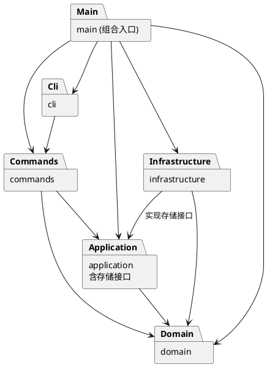

# SVG 编辑器：架构方案与开发记录

本项目使用 TypeScript 实现 CLI 版 SVG 编辑器，支持六种内置图形、文档读写、树结构编辑和撤销重做。开发中使用 Codex 辅助分析需求、生成实现与测试，并根据运行结果修订方案。

本文件为完整作业文档，包含使用说明、架构方案和开发记录。逐项验收结果见[最终检查记录](final-review.md)。

### 安装、运行与调试

需要 Node.js 22 或更新版本。以下命令均在项目根目录执行：

```powershell
npm.cmd ci
npm.cmd run cli
```

macOS、Linux 或其他终端可使用 `npm` 代替 `npm.cmd`。进入交互后输入 `help` 查看全部命令，Ctrl+C 或 EOF 退出。`src/` 中的 `.ts` 是源码，`dist/` 中的 `.js` 由 `npm run build` 生成。

用 VS Code 打开项目目录，在 `src/main.ts` 或 `src/cli/CliApplication.ts` 设置断点，按 F5 选择“调试 SVG CLI”，在集成终端输入命令。

### 命令与样例

支持 `init / read / save / canvas / create / delete / move / scale / set / group / ungroup / addto / front / back / tree / show / help / undo / redo`。

```text
init 400 300
create g node
create rect r 10 20 120 60 #4a90d9 in node
create text label 25 55 "开始" in node
move node 20 10
undo
tree
save demo.svg
```

交互终端显示 `svg>`；管道回放省略提示符。Windows PowerShell 回放中文脚本时先设置 UTF-8：

```powershell
$OutputEncoding = [System.Text.UTF8Encoding]::new($false)
Get-Content -Encoding utf8 examples/flowchart.commands.txt | npm.cmd run cli
```

完整脚本见 [flowchart.commands.txt](../examples/flowchart.commands.txt)，生成的 [flowchart.svg](../examples/flowchart.svg) 可直接用浏览器打开。`read examples/other.svg` 可读取作业外部样例并查看自动补 ID 警告。

显式 `save demo.svg` 后，无参数 `save` 使用最近一次成功 read/save 的路径；init 清除该路径。读写失败保留当前文档与历史。

## 1. 架构方案

### 1.1 模块划分

| 模块 | 职责 |
| --- | --- |
| `src/main.ts` | 组合入口，创建会话、工厂、存储实现和命令分发器 |
| `src/cli/` | REPL、参数分词、提示符，以及成功反馈和错误输出 |
| `src/commands/` | 独立命令类、参数校验和命令分发 |
| `src/application/` | 当前文档、历史管理、文档存储接口与结构查询 |
| `src/domain/` | 画布、图形、组合容器、树结构约束、工厂与状态快照 |
| `src/infrastructure/` | 文件读写、XML 解析和 SVG 序列化 |
| `tests/` | 领域行为、命令流程、历史恢复与文件往返测试 |
| `examples/`、`scripts/` | 可回放样例及浏览器视觉验收脚本 |

每个类放在同名文件中。图形属性和子节点集合由对象封装，通过方法维护数值、唯一 ID 和树结构约束。

以下为 PlantUML 包图，箭头表示依赖方向：



### 1.2 设计模式及实现

| 模式或原则 | 对应代码 | 选择理由 |
| --- | --- | --- |
| Command | `Command`、各命令类、`EditCommand`、`CommandHistory` | 将输入处理与编辑操作分开，一条成功编辑对应一个历史单元 |
| Composite | `Shape`、`Group`、`walk()` | 叶子与容器使用相同的 move/scale/set/delete 操作入口，嵌套容器通过多态遍历子树 |
| Memento | `SnapshotEdit`、`CanvasSnapshot`、`ShapeState` | 保存编辑前后状态，精确恢复属性、文本、父级及兄弟位置 |
| Factory 与适配器 | `ShapeFactory`、`ShapeInput`、`CommandShapeInput`、`XmlShapeInput` | CLI 和 XML 共用图形类型注册表，各自处理输入格式 |
| 依赖倒置 | `DocumentStore`、`FileDocumentStore` | 应用依赖存储接口，由入口注入文件实现，方便替换存储方式 |

历史管理在编辑成功后入栈，并清空 redo。失败编辑恢复操作前状态，保留已有历史。init/read/save 和画布尺寸修改在成功后建立历史屏障；tree/show/help 及尺寸查询不进入历史。

采用完整内存快照，是为了处理分组、子树删除和缺省属性恢复等情况，也能避免用反向缩放恢复时产生浮点误差。代价是每个历史单元占用 O(文档大小) 内存；本阶段未做差量压缩或磁盘历史。

按名字分派仅集中在 `CommandDispatcher` 和 `ShapeFactory` 两个注册表，均列为后续插件化阶段的待重构项。图形的几何操作、文本处理与子树遍历通过对象多态实现。

### 1.3 依赖方向规则

| 模块 | 允许依赖 | 原因 |
| --- | --- | --- |
| domain | 本层 | 保持模型独立于终端、文件系统和 XML 库 |
| application | 本层、domain | 协调用例，定义存储接口，管理当前文档与历史 |
| commands | 本层、application、domain | 校验命令参数并调用应用或领域对象 |
| cli | 本层、commands、Node 终端接口 | 负责交互，通过命令执行编辑 |
| infrastructure | 本层、application、domain、文件与 XML 库 | 实现存储接口，将外部格式转换为领域对象 |
| main.ts | 各业务模块 | 装配具体依赖 |

新增依赖需要符合此表；发生方案调整时，在过程记录中说明原因。

### 1.4 变化点假设

| 可能的变化 | 当前安排及取舍 |
| --- | --- |
| 新命令、GUI 或其他输入入口 | 命令对象与终端分离，其他入口可复用应用和领域操作 |
| 新图形类型 | 保留图形抽象和集中工厂；box 与插件加载属于后续阶段，本阶段不实现 |
| 存储媒介或 XML 库 | 用 DocumentStore 隔离应用与文件实现 |
| 新属性 | 各图形类维护自身属性规则，公共样式由基类处理 |
| 历史容量增大 | 历史集中管理，后续可替换快照策略；当前优先保证恢复准确 |
| 显示格式 | DocumentInspector 生成 tree/show 文本，CLI 负责输出 |

### 1.5 需求中的补充约定

- 仅以 `#` 开头的整行视为注释，颜色参数中的 `#` 保留；文本参数支持双引号和转义。
- group 按原文档遍历顺序收编节点。同父时占据首个所选节点的位置；跨父时插入最近公共祖先下、首个被选分支之前。
- 根级 g 禁止 ungroup；嵌套容器解组后，子节点占据原容器位置。addto/group 在修改前检查循环和祖先冲突。
- 普通 g 的样式遵循 SVG 继承。scale 缩放位置和几何尺寸，字号与描边宽度等样式保持原值。
- 外部 SVG 支持六种内置标签及无单位、px 几何长度；保留 viewBox、transform 和字体等属性。编辑作用于本地坐标，修改画布尺寸会重置 viewBox。其他标签、百分比及其他长度单位、DOCTYPE 报错；原始注释和排版不保留。

## 2. 与 AI 协作的过程记录

Codex 参与了需求拆解、项目骨架、领域模型、命令、测试和文档的编写。协作中主要依据作业要求、类型检查、回归测试和实际渲染结果判断方案是否可用。下面记录有代表性的调整。

### 2.1 从骨架到领域模型

先建立 TypeScript 严格模式配置和模块方案，再实现图形及容器。检查容器移动、缩放时发现：如果逐个修改子节点，后面的节点数值溢出会留下部分修改。于是改为先计算并验证整棵子树，再统一写回；测试用后续节点溢出的场景确认前面节点保持原值。

运行时测试通过后，类型检查仍发现 `Shape` 与 `ShapeContainer` 的身份比较存在类型错误。修正比较方式后，把测试源码也纳入类型检查。另补充 `.vscode/launch.json`，通过 `node --import tsx` 在集成终端启动 CLI。

### 2.2 命令解析与撤销重做

CLI 解析保留参数是否带引号的信息，用于区分文本内容 `"in"` 和容器后缀 `in <id>`，并避免将颜色当作注释。

撤销方案从保存操作差量调整为编辑前后快照。重点验证了：分组一次撤销还原全部节点、删除后恢复子树、原本未设置的样式恢复为缺省状态，以及浮点几何值精确恢复。模拟编辑中途抛错后，文档和已有 redo 均能恢复。

### 2.3 工厂迁移与 SVG 读写

工厂最初位于命令层。实现 XML 读入时发现，直接复用会使 infrastructure 依赖 commands，违反方案。随后将 `ShapeFactory` 移入 domain，并提取 `ShapeInput`，由 CLI 和 XML 分别适配输入。

导入 viewBox 后，检查撤销发现快照恢复调用 resize 会清除根属性。改为由 Canvas 封装尺寸和根属性快照，并补充导入、编辑、撤销、保存读回的测试。

### 2.4 根据失败用例修复解析和保存问题

以下问题均先通过失败用例复现，再修复并运行相关及完整测试：

| 问题 | 调整与验证 |
| --- | --- |
| Number(value) 接受 `0x10` 等进制字符串 | 增加十进制浮点及指数格式校验；非法设置保留原属性 |
| 注释或 CDATA 中的 DOCTYPE 字样被误拒绝 | 检查实际 Document.doctype 节点，普通文本可保存读回，真实 DOCTYPE 继续拒绝 |
| `stroke-width="2px"` 及带首尾空白的长度无法导入 | 统一 SVG 长度解析，保留数值、单位和非负检查 |
| `stroke-width="inherit"` 无法导入 | 导入时保留继承关键字，验证读回和快照恢复 |
| 回车字符实体保存后变成换行 | 序列化时用字符引用保留回车，验证回车、换行、制表符往返 |
| XML 禁用控制字符被写入文件 | 启用严格序列化，验证保存失败时原文件和命令历史不变 |

### 2.5 样例回放与视觉验收

最初分析将流程图误数为 9 个元素；实际回放确认是 8 个，原需求正确。以运行结果纠正了计数和文档说明。

Windows PowerShell 的默认管道编码曾使中文变成问号，设置 UTF-8 后重新生成例图，并用独立 Node 进程回放确认中文内容。

使用 Playwright 调用本机 Edge，生成原图、节点移动、整体缩放和撤销恢复四种状态的截图。检查了中文、颜色、文本范围和节点位置；撤销恢复图与原图逐字节一致。截图和测量结果见[视觉验收记录](visual-acceptance.md)。

## 3. 一致性自查

### 模块划分

实际业务目录与方案一致，另有 examples 和 scripts 用于样例与验收。工厂迁移、历史快照策略和外部 SVG 支持范围的调整已记入过程记录。

### 依赖方向

最终检查覆盖 54 个模块文件、49 个类及 175 处导入，类名与文件名一致，未发现违反当前依赖规则的导入。具体例子：

- `SnapshotEdit` 依赖 domain 的快照对象，应用层不引用具体命令类。
- `FileDocumentStore` 实现 application 的存储接口；`SvgCodec` 使用 domain 的工厂，不引用 commands。
- domain 不依赖终端、文件系统或 XML 库；命令类不直接执行终端与文件 IO。

检查范围和逐项依据见[最终检查记录](final-review.md)。

## 4. 功能完整性与质量保证

已接齐需求中的 19 个命令。当前 34 项自动化测试、类型检查、构建和 Edge 视觉验收均通过。

| 验证范围 | 重点检查 |
| --- | --- |
| 领域模型 | 六种图形、嵌套容器、移动缩放、属性白名单、唯一 ID、数值及循环约束 |
| 命令与交互 | 双引号、转义、颜色、空文本、错误后继续执行、CRLF 与无末尾换行脚本 |
| 历史与层级 | 整段命令撤销重做、跨父分组、解组顺序、重新归属、z-order、历史分支和文档屏障 |
| SVG 与文件 | XML 转义、缺 ID 补全、重复 ID、默认路径、失败保护、属性及文本往返 |
| 需求样例 | 外部 SVG 的 7 个元素、完整流程图的 8 个元素及中文内容 |
| 浏览器渲染 | 四种状态的文字、颜色、几何位置，以及撤销前后截图一致性 |

复现命令：

```powershell
npm.cmd ci
npm.cmd run check
npm.cmd test
npm.cmd run build
npm.cmd run visual:check
```

视觉验收需要本机 Edge。当前验证环境为 Windows、Node.js 24.14.0、Edge 156.0.4314.42；其他平台尚未验证。超大文档性能、任意外部 SVG 和插件加载不在本阶段验证范围内。

代码与文档已推送至 [GitHub](https://github.com/AutNiHilo-carry/svg-editor-cli)，交付版本由 [final 标签](https://github.com/AutNiHilo-carry/svg-editor-cli/tree/final)标记。
