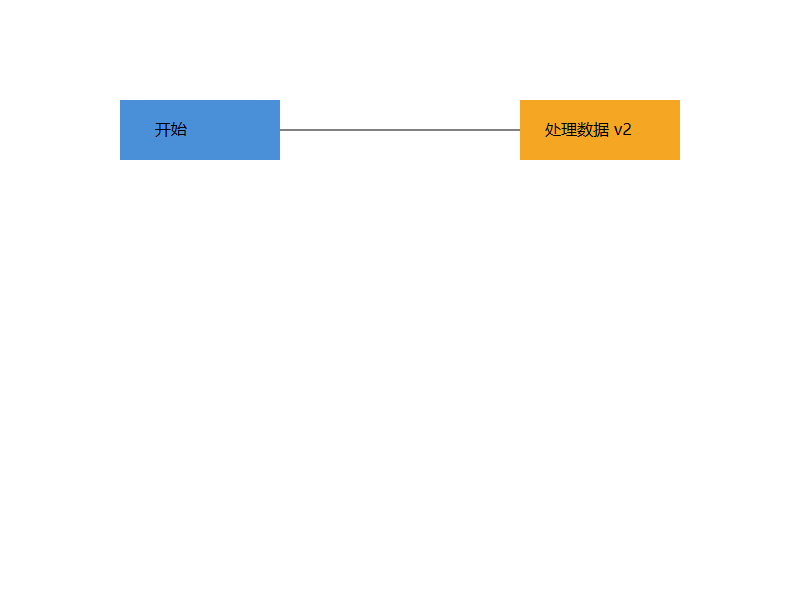
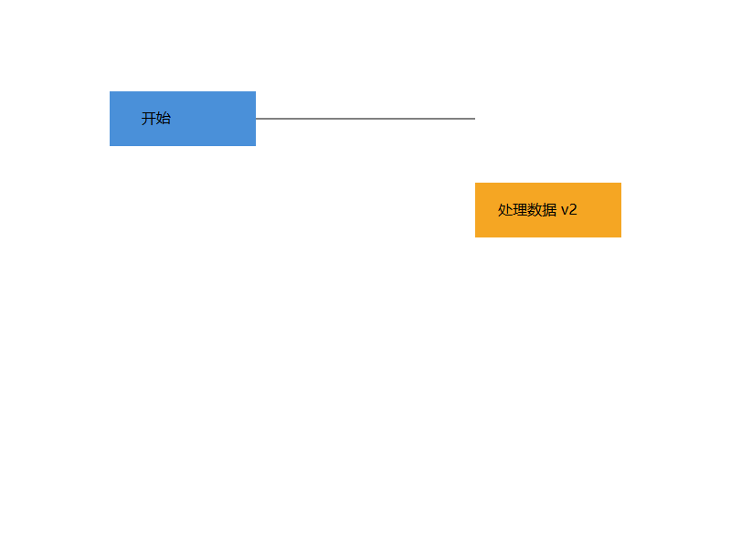
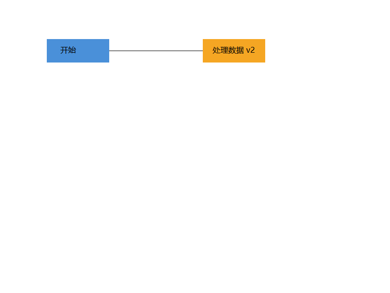

# SVG 浏览器视觉验收

验收日期：2026-10-25（香港时间）。

使用本机 Microsoft Edge 156.0.4314.42 的无界面浏览器渲染，截图区域为 SVG 自身的 800×600 画布，设备像素比为 1。输入为 `examples/flowchart.svg`，SHA-256 和浏览器实测边界存于 [measurements.json](previews/measurements.json)。图片由真实浏览器生成，已查看原图、移动和缩放截图；撤销恢复图另经文件内容比对。

## 结果

| 检查项 | 实际观察 | 结论 |
| --- | --- | --- |
| 中文 | “开始”和“处理数据 v2”清晰，无问号或方框 | 通过 |
| 填充色 | 左侧 #4a90d9，右侧 #f5a623；浏览器计算色值与源文件一致 | 通过 |
| 节点位置 | 原图两个矩形分别位于 (120,100)、(520,100)，均为 160×60 | 通过 |
| 文本范围 | 两段文字的浏览器包围盒均在对应矩形内 | 通过 |
| 连线 | 原图线段从 (280,130) 延伸至 (520,130)，连接两矩形边界 | 通过 |
| 容器移动 | `move node2 0 100` 后右侧矩形 y=200，文字同步下移 100；左侧节点保持原位 | 通过 |
| 整体缩放 | `scale flowchart 0.8` 后左侧矩形为 (96,80)、128×48，右侧为 (416,80)；节点与连线几何同步变化 | 通过 |
| 撤销恢复 | 移动右侧节点后 undo、保存、重新加载；截图与原图逐字节一致 | 通过 |
| 结构数量 | 四种状态均有 8 个图形元素，不计 svg 根 | 通过 |

## 预览

原始流程图：



右侧节点下移 100：



整体几何缩放至 0.8：



[查看撤销恢复截图](previews/undo-restored.png)。

## 语义说明

连线属于 `flowchart` 容器，移动 `node2` 只移动该节点中的矩形和文字，连线继续保留原坐标。编辑器提供普通 SVG line，当前没有自动布线功能。

scale 按需求缩放位置和几何尺寸，字号、描边宽度等样式保持原值；因此缩放截图中的文字仍使用原字号。两段文字在本次缩放场景中均完整位于矩形内。

本次验收针对当前流程图的四种状态，未覆盖任意外部 SVG、所有字体环境或全部导入 transform 组合。自动化行为测试另覆盖六种内置图形及文件往返。

## 复现

安装项目依赖并确认本机已有 Edge：

```powershell
npm.cmd ci
npm.cmd run visual:check
```

脚本使用 Playwright 启动本机 Edge，不需要下载另一份浏览器；如浏览器不在默认位置，可设置 `$env:SVG_BROWSER_PATH` 为本机 Chromium 系浏览器可执行文件路径。

脚本直接通过 UTF-8 向 CLI 传递命令，在系统临时目录生成移动、缩放和恢复版本，结束后清理临时 SVG；原始示例不变。截图和实测结果写入 `doc/previews/`。不同平台的字体栅格化结果可能不同，撤销一致性只比较同一次运行的原图和恢复图。
